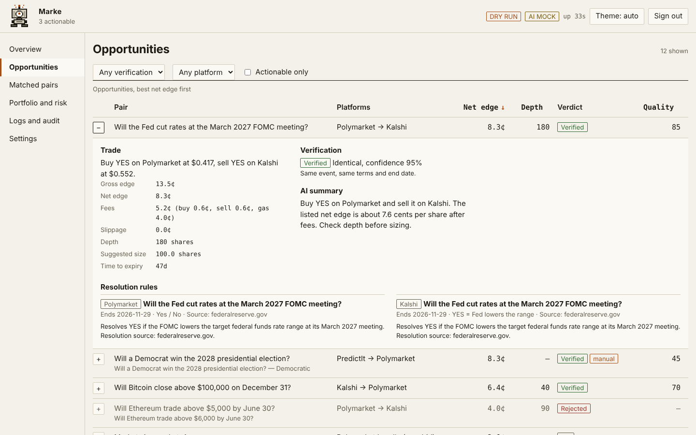
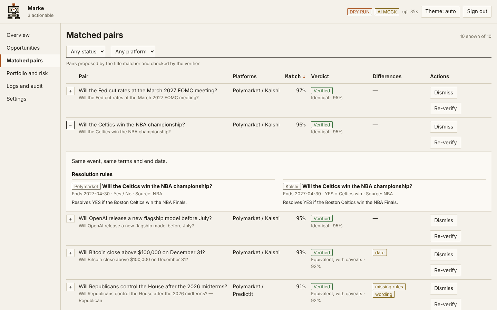

# Marke: prediction-market arbitrage monitor

Marke watches Polymarket, Kalshi and (optionally) PredictIt for price gaps between markets that
describe the same event, and shows them in a login-protected dashboard. It is an **advisory tool**:
it never places orders, and live trading is disabled in this build. You decide, and trade by hand.

Originally by [ImMike](https://github.com/ImMike).



## What it does

- **Finds candidate pairs.** A title matcher proposes Polymarket/Kalshi/PredictIt pairs that look alike.
- **Checks them with an LLM gate.** Titles that look alike often resolve differently (another date,
  threshold, source, or YES meaning NO). Every cross-platform pair goes through a verifier that reads
  both markets' resolution rules. A pair is *actionable* only if the model call succeeded **and** its
  verdict clears the confidence thresholds. Anything else is shown as rejected or unverified. The gate
  fails closed: AI off, budget used up, provider error or malformed output all mean "not actionable".
- **Explains verified opportunities.** An analyst writes a short plain-English summary, lists risks
  and gives a quality score. Prices, fees and edges always come from code, never from the model.
- **Also detects** single-market bundle gaps (YES + NO asks below $1) on Polymarket.
- **Keeps state in a database** (SQLite by default, Postgres by changing `DATABASE_URL`): users,
  sessions, verdict and analysis caches, opportunity history, audit log, AI budget, dismissed pairs.



## Quick start

```bash
python -m venv venv && source venv/bin/activate
pip install -r requirements.txt          # tests: pip install -r requirements-dev.txt

cp .env.example .env                     # add GEMINI_API_KEY (optional, see "AI settings")
python -m app.create_user --username owner   # prompts for a password (12+ characters)

python run_with_dashboard.py             # http://127.0.0.1:8000
```

There are no default credentials and no sign-up page. The first user is created with the command
above; add more with `--add`. The dashboard binds to `127.0.0.1` by default.

### Try it with no network or API key

```yaml
# config.yaml
mode:
  data_mode: simulation
ai:
  provider: mock      # deterministic fake verifier, labelled MOCK in the UI
```

Simulation mode seeds a demo set of synthetic Polymarket, Kalshi and PredictIt pairs that covers every
verdict (verified, rejected as different, rejected as inverse). Nothing in it is real market data.

### Docker

```bash
cp .env.example .env
docker compose build
docker compose run --rm app python -m app.create_user --username owner
docker compose up -d
```

The port is published on `127.0.0.1:8000` only, the database lives in the `marke-data` volume, and
the container runs as a non-root user with a health check on `/healthz`. For access from other
machines, put an HTTPS reverse proxy in front: see [docs/deploy.md](docs/deploy.md). To host it
without running anything on your own computer, see [docs/railway.md](docs/railway.md) (about $5/month) or
[docs/render.md](docs/render.md) (free, with limits).

## Security model

| Concern | What Marke does |
|---|---|
| Passwords | argon2id, re-hashed on login when parameters change; unknown users cost the same time as known ones |
| Sessions | Random token in an `HttpOnly`, `SameSite=Strict`, `Secure` cookie; only a hash is stored; idle (2h) and absolute (12h) expiry; rotated on login |
| Brute force | 5 failures lock the account for 15 minutes; 20 attempts per IP per 15 minutes; generic error messages |
| CSRF | `Origin`/`Referer` must match the host, plus a per-session `X-CSRF-Token` on every state-changing request |
| Access | Deny by default: only `/login`, its assets, `/api/auth/login` and `/healthz` are public. The WebSocket checks origin and session before the handshake and again on every heartbeat |
| Browser | CSP `default-src 'self'` (no inline script or style), `nosniff`, `no-referrer`, `frame-ancestors 'none'`, trusted-host checks, no CORS unless configured |
| Secrets | Read from the environment or `.env`; the loader warns if it finds them in `config.yaml` |
| Trading | `trading_mode: live` is rejected at config load; `--live` exits with an error |

## AI settings

```yaml
ai:
  enabled: true
  provider: gemini                 # gemini | mock (anthropic is a stub)
  model: gemini-3.1-flash-lite
  min_confidence: 0.80             # "identical" verdicts
  min_confidence_caveats: 0.90     # "equivalent with caveats"
  daily_call_budget: 400
  requests_per_minute: 10
```

- **Key:** set `GEMINI_API_KEY` in `.env`. Without it every pair stays unverified.
- **Free tier:** Google no longer publishes the free-tier daily request limit for Flash-Lite
  models; third-party sources report about 500 requests a day. The defaults (400 calls a day, 10 a
  minute) sit under that. A 429 fails closed and is retried with backoff. Check the current quota in
  Google AI Studio and adjust.
- **Privacy:** on the free tier Google may use prompts to improve its products. Only public market
  titles and rules text are sent; no config, keys or environment values can reach a prompt.
- **Temperature:** unset by default, which means Google's default (Google advises against lowering
  it for Gemini 3). Repeatability comes from the strict output schema, the verdict cache and a low
  thinking level. Set `ai.temperature` to override it.
- **Cost:** `ai.pricing` holds per-million-token prices used for the cost estimate shown in the UI.
  The shipped numbers are estimates; check Google's pricing page. `daily_cost_budget_usd: 0` means no cap.
- **Cache:** verdicts are keyed by the two markets' text, the model and the prompt version, so the same
  pair is never paid for twice, and changing the model re-verifies.
- **Kill switch:** turn AI off in Settings (or `ai.enabled: false`). Every pair becomes unverified.
- **Prompt injection:** market text is sent as delimited, length-capped, control-character-stripped
  data, and the system prompt tells the model to ignore instructions inside it. The model's output has
  no price fields, and `core/ai` cannot import any order, risk or portfolio code (a test enforces it).

## PredictIt

Off by default (`predictit.enabled: false`). It is read-only: Marke polls the public market-data feed
at most once a minute and never trades there.

- PredictIt's API has **no resolution rules**, so those pairs are verified from titles alone and can
  reach at most "equivalent with caveats" at the 0.90 threshold.
- It publishes **no order sizes**, so depth shows as "not published".
- Fees are modelled as 10% of profit on the winning contract, plus an optional 5% withdrawal fee
  (`apply_withdrawal_fee`). Edges are the worst case across outcomes. Contracts are capped at $850.
- Every PredictIt opportunity is flagged **place manually**.
- The JSON shape here comes from third-party documentation. Run once with `predictit.enabled: true`
  and check the Matched pairs screen before relying on it.
- **PredictIt data is licensed for non-commercial use only.**

## Configuration

`config.yaml` is documented inline. Credentials never go in it: use `.env` (see `.env.example`).

| Section | Notes |
|---|---|
| `server` | `host`, `port`, `cookie_secure`, session lifetimes, `allowed_hosts`, `allowed_origins`, `hsts` |
| `database` | `url` (or `DATABASE_URL`), `auto_migrate` runs `alembic upgrade head` at startup |
| `ai`, `predictit` | As above |
| `mode` | `data_mode` (`real` or `simulation`), `cross_platform_enabled`, `kalshi_enabled`, `min_match_similarity`, scan cadence |
| `trading`, `risk` | Edge thresholds, sizing and limits for the single-market strategies |

Some settings can be changed from the Settings screen (AI on/off, thresholds, budgets, source toggles,
minimum edge). They are validated against a whitelist, saved, and written to the audit log. Trading
mode cannot be changed from the web.

## Project layout

```
app/                 config, SQLAlchemy models, repo, auth, CSRF, settings, create_user CLI
migrations/          Alembic (0001_initial)
core/ai/             provider interface, Gemini/mock providers, runner (budget, rate limit, retries),
                     verifier (the gate), analyst, verification queue
core/                market matcher and edge maths, fees, pair store, cross-platform scanner, data feed
polymarket_client/   kalshi_client/   predictit_client/   exchange clients (read-only for cross-platform)
dashboard/           FastAPI app: security middleware, auth/API routes, WebSocket, static UI
dashboard/static/    login page and the dashboard (vanilla ES modules, no build step)
tests/               pytest suite
```

## Tests

```bash
pip install -r requirements-dev.txt
pytest -q
```

## Disclaimer

Educational software. Prediction markets carry risk, fees and settlement differences that a matcher or
an LLM can miss. Read both markets' rules yourself before trading, and never rely on the verdict alone.

MIT License, as declared by the original project (this repository does not currently include a LICENSE file).
